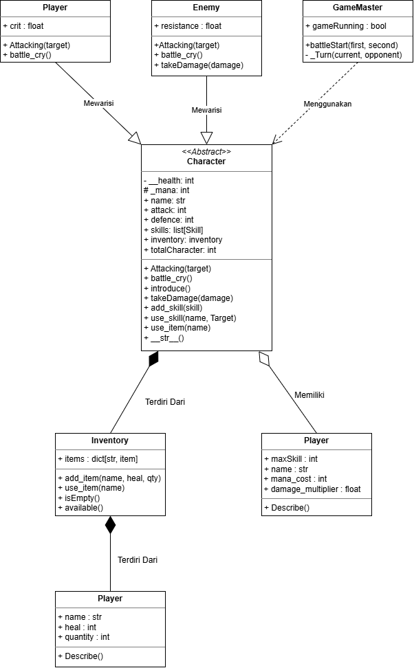
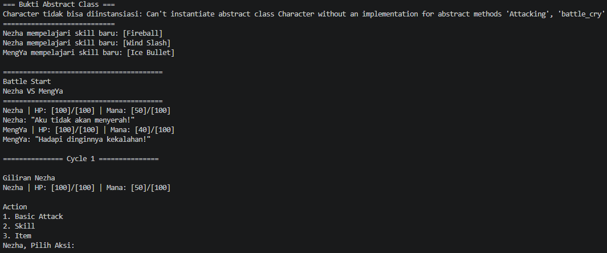

# Turn-Based Battle Game (Python OOP)

Program ini adalah simulasi pertarungan (battle) berbasis giliran atau turn-based antara dua karakter, yang saya buat menggunakan konsep Object-Oriented Programming (OOP) di Python. Lewat program ini saya mencoba menerapkan beberapa konsep OOP sekaligus, mulai dari encapsulation, inheritance, abstraksi (ABC), sampai polymorphism, bukan cuma class yang berdiri sendiri-sendiri.

**Identitas Pembuat**
- Nama : Pirlo Syabila Hafuza
- NIM : 2509106008
- Kelas : A1'25

---

## 1. Deskripsi Program

Secara garis besar, program ini mensimulasikan pertarungan 1 lawan 1 antara seorang `Player` dan seorang `Enemy`. Keduanya saya buat sebagai turunan (subclass) dari satu abstract class yang sama, yaitu `Character`, supaya statistik dasarnya (HP, attack, defence, mana) tidak perlu saya tulis ulang di masing-masing class.

Tiap karakter bisa mempelajari skill khusus dan membawa item lewat sistem inventory sendiri. Pertarungan berjalan bergantian antara Player dan Enemy, dan berhenti begitu salah satu dari mereka kehabisan HP.

Beberapa hal yang saya coba terapkan di program ini:
- Validasi otomatis untuk HP, supaya nilainya tidak pernah lebih dari 100 atau kurang dari 0.
- Sistem mana yang membatasi seberapa sering skill bisa dipakai.
- Skill yang punya damage multiplier dan biaya mana masing-masing.
- Batas jumlah skill yang bisa dipelajari satu karakter, diatur lewat `Skill.maxSkill`.
- Sistem Inventory sederhana untuk menyimpan dan memakai item pemulih HP.
- Abstract class `Character` dengan dua abstract method (`Attacking()` dan `battle_cry()`) yang wajib diimplementasikan oleh subclass-nya.
- Inheritance antara `Character`, `Player`, dan `Enemy`, di mana masing-masing subclass punya kelakuan unik:
  - `Player` punya peluang Critical Hit (damage dikalikan dua) dan memulihkan sedikit mana setiap kali basic attack.
  - `Enemy` punya resistance yang mengurangi persentase damage yang ia terima.
- Penghitung otomatis berapa banyak karakter yang pernah dibuat selama program berjalan, lewat `totalCharacter`.
- Alur pertarungan yang interaktif, jadi pemain benar-benar memilih aksi lewat input di terminal.

---

## 2. Struktur Class



### 2.1 `Character` (Abstract Base Class)

Ini class dasar yang menyimpan semua hal umum yang dimiliki setiap karakter, baik itu Player maupun Enemy. Class ini turunan dari `ABC`, jadi tidak bisa dibuat objeknya secara langsung.

**Atribut:**
| Atribut | Tipe | Keterangan |
|---|---|---|
| `name` | str | Nama karakter |
| `__health` | int (private) | HP karakter, hanya bisa diakses lewat property `health` |
| `attack` | int | Nilai serangan dasar |
| `defence` | int | Nilai pertahanan |
| `_mana` | int (protected) | Mana yang dimiliki karakter, diakses lewat property `mana` |
| `skills` | list | Kumpulan skill yang sudah dipelajari karakter |
| `inventory` | Inventory | Objek inventory milik karakter tersebut |
| `totalCharacter` | int (class variable) | Jumlah total karakter yang pernah dibuat sejak program berjalan |

**Property:**
Saya sengaja membungkus `health` dengan property, bukan atribut biasa, karena nilainya perlu divalidasi tiap kali diubah:
- `health` (getter) — mengembalikan HP yang sedang berlaku.
- `health` (setter) — kalau nilainya lebih dari 100, otomatis dipaksa jadi 100 dan muncul pesan peringatan. Kalau kurang dari 0, dipaksa jadi 0 dengan peringatan juga. Selain itu, nilainya disimpan apa adanya.
- `mana` (getter) — mengembalikan mana yang sedang dimiliki (hanya bisa dibaca dari luar class).

**Abstract method:**
| Method | Fungsi |
|---|---|
| `Attacking(target)` | Aksi basic attack ke target, diimplementasikan berbeda oleh `Player` dan `Enemy` |
| `battle_cry()` | Mencetak teriakan perang karakter, diimplementasikan berbeda oleh `Player` dan `Enemy` |

**Method biasa:**
| Method | Tipe | Fungsi |
|---|---|---|
| `introduce()` | instance | Mencetak status karakter (lewat `__str__`), lalu memanggil `battle_cry()` milik subclass masing-masing |
| `total_character()` | classmethod | Mengembalikan string jumlah total karakter yang sudah pernah dibuat |
| `calculate_damage(attack, defence)` | staticmethod | Menghitung damage bersih dari selisih attack dan defence, minimal 1 supaya tidak pernah 0 atau negatif |
| `isAlive()` | instance | Mengecek apakah karakter masih hidup (`health > 0`) |
| `takeDamage(damage)` | instance | Mengurangi HP berdasarkan damage yang sudah dihitung lewat `calculate_damage` terhadap `defence` karakter |
| `add_skill(skill)` | instance | Menambahkan skill baru ke list `skills`, selama belum melewati batas `Skill.maxSkill` |
| `use_skill(skill_name, target)` | instance | Mencari skill berdasarkan nama (tidak peka huruf besar/kecil), lalu memakainya kalau mana-nya cukup |
| `use_item(item_name)` | instance | Mengambil item dari inventory dan memakainya untuk memulihkan HP (maksimal 100) |
| `__str__()` | dunder | Menampilkan nama, HP, dan mana karakter dalam satu baris |

### 2.2 `Player(Character)`

Subclass dari `Character` yang mewakili karakter yang dikendalikan pemain.

**Atribut tambahan:**
| Atribut | Tipe | Keterangan |
|---|---|---|
| `crit` | float | Peluang terjadinya Critical Hit, defaultnya 0.3 (30%) |

**Method yang saya override:**
| Method | Fungsi |
|---|---|
| `Attacking(target)` | Basic attack versi Player: ada kemungkinan damage dikalikan dua kalau Critical Hit terjadi, dan mana Player otomatis pulih 5 setiap kali menyerang (maksimal 100) |
| `battle_cry()` | Mencetak teriakan khas Player: `"Aku tidak akan menyerah!"` |

### 2.3 `Enemy(Character)`

Subclass dari `Character` yang mewakili karakter lawan.

**Atribut tambahan:**
| Atribut | Tipe | Keterangan |
|---|---|---|
| `resistance` | float | Persentase pengurangan damage yang diterima, defaultnya 0.2 (20%) |

**Method yang saya override:**
| Method | Fungsi |
|---|---|
| `Attacking(target)` | Basic attack versi Enemy: menyerang target dengan nilai `attack` apa adanya, tanpa critical hit dan tanpa pemulihan mana |
| `battle_cry()` | Mencetak teriakan khas Enemy: `"Hadapi dinginnya kekalahan!"` |
| `takeDamage(damage)` | Damage yang masuk dikurangi dulu sesuai `resistance`, baru diteruskan ke `takeDamage` milik `Character` |

### 2.4 `Skill`

Class sederhana untuk merepresentasikan satu kemampuan khusus yang bisa dipelajari karakter.

**Atribut:**
| Atribut | Tipe | Keterangan |
|---|---|---|
| `maxSkill` | int (class variable) | Batas maksimal skill yang boleh dimiliki satu karakter, defaultnya 3 |
| `name` | str | Nama skill |
| `mana_cost` | int | Mana yang dibutuhkan untuk memakai skill ini |
| `damage_multiplier` | float | Pengali damage dasar saat skill ini digunakan |

**Method:**
| Method | Fungsi |
|---|---|
| `describe()` | Mengembalikan deskripsi singkat skill, misalnya `Fireball (Mana: 20)` |

### 2.5 `Item`

Class kecil yang merepresentasikan satu jenis item pemulih HP.

**Atribut:**
| Atribut | Tipe | Keterangan |
|---|---|---|
| `name` | str | Nama item |
| `heal` | int | Jumlah HP yang dipulihkan saat item dipakai |
| `quantity` | int | Jumlah item yang tersisa |

**Method:**
| Method | Fungsi |
|---|---|
| `describe()` | Mengembalikan deskripsi singkat item, misalnya `Potion x 2 (Heal: 30)` |

### 2.6 `Inventory`

Saya pisah jadi class sendiri supaya logika penyimpanan item tidak numpuk di `Character`.

**Atribut:**
| Atribut | Tipe | Keterangan |
|---|---|---|
| `items` | dict | Menyimpan objek `Item` dengan nama item sebagai key |

**Method:**
| Method | Fungsi |
|---|---|
| `add_item(name, heal, quantity)` | Membuat objek `Item` baru, atau menambah jumlahnya kalau item itu sudah ada |
| `use_items(name)` | Mengurangi jumlah item dan mengembalikan nama serta nilai heal-nya, kalau stok masih ada |
| `isEmpty()` | Mengecek apakah semua item sudah habis |
| `available()` | Mengembalikan daftar item yang stoknya masih tersisa |

### 2.7 `tampilkan_daftar(judul, daftar)`

Fungsi biasa (bukan method) yang menerima judul dan daftar objek apa pun yang punya method `describe()`, lalu mencetaknya satu per satu beserta opsi `back`. Fungsi ini dipakai untuk menampilkan daftar skill maupun item.

### 2.8 `GameMaster`

Class yang bertugas menjalankan dan mengatur alur pertarungan antara dua karakter.

**Atribut:**
| Atribut | Tipe | Keterangan |
|---|---|---|
| `gameRunning` | bool (class variable) | Menandai status permainan |

**Method:**
| Method | Fungsi |
|---|---|
| `battleStart(first, second)` | Menerima dua karakter lewat parameter, memperkenalkan keduanya, lalu menjalankan loop pertarungan sampai salah satu karakter kalah dan mengembalikan hasil akhirnya |
| `_Turn(current_character, opponent)` | Mengurus satu giliran: menampilkan status HP/mana, meminta pemain memilih aksi, lalu mengeksekusinya |

---

## 3. Abstraksi

Pada program ini saya menerapkan abstraksi lewat modul `abc`:

- **Abstract class:** `Character(ABC)`, sehingga `Character` tidak bisa langsung dibuat objeknya.
- **Abstract method (2):** `Attacking(target)` dan `battle_cry()`, keduanya ditandai dengan `@abstractmethod` dan wajib diimplementasikan oleh subclass.
- **Subclass yang mengimplementasikan keduanya:** `Player` dan `Enemy`, masing-masing dengan perilaku berbeda (Player punya critical hit dan pemulihan mana, Enemy menyerang biasa dan punya `resistance`).
- **Instance method yang dipakai bersama:** `introduce()`, `takeDamage()`, `isAlive()`, `add_skill()`, `use_skill()`, `use_item()`. Contohnya `introduce()` mencetak status lalu memanggil `battle_cry()` milik subclass masing-masing.
- **Inheritance tetap dipakai:** `super().__init__(...)`, atribut unik tiap subclass (`crit`, `resistance`), atribut private (`__health`) dan protected (`_mana`).

### Bukti Abstract Class Tidak Bisa Diinstansiasi

Untuk membuktikan bahwa `Character` benar-benar abstract, saya menambahkan percobaan membuat objeknya langsung di bagian `if __name__ == "__main__":`, sebelum pertarungan dimulai. Percobaan ini dibungkus `try-except TypeError`, jadi program tidak berhenti dan pesan errornya ikut tercetak:

```python
try:
    Character("Test", 100, 10, 5, 50)
except TypeError as e:
    print(f'Character tidak bisa diinstansiasi: {e}')
```

Python menolak pembuatan objek tersebut karena `Character` masih punya abstract method (`Attacking` dan `battle_cry`) yang belum diimplementasikan. Output yang muncul di awal program (screenshot-nya ada di bagian 11):

```
=== Bukti Abstract Class ===
Character tidak bisa diinstansiasi: Can't instantiate abstract class Character without an implementation for abstract methods 'Attacking', 'battle_cry'
============================
```

Karena pembuatan objek ini gagal, `totalCharacter` tidak bertambah, sehingga total karakter di akhir program tetap `[2]` (hanya `Nezha` dan `MengYa`). Sebaliknya, `Player` dan `Enemy` berhasil dibuat karena keduanya sudah mengimplementasikan kedua abstract method tersebut.

---

## 4. Polimorfisme

### 4.1 Polimorfisme lewat pewarisan
`Attacking()` dan `battle_cry()` di-override oleh `Player` dan `Enemy` dengan perilaku berbeda (`Enemy` juga meng-override `takeDamage()` untuk menahan damage sesuai `resistance`). Pemanggilannya terjadi lewat satu loop di `GameMaster.battleStart()`, yang berisi objek dari subclass berbeda:

```python
for character in (first, second):   # Player dan Enemy
    character.introduce()           # memanggil battle_cry() milik masing-masing
```

Di dalam loop pertarungan, `_Turn()` memanggil `current_character.Attacking(opponent)` tanpa peduli apakah objeknya `Player` atau `Enemy`.

### 4.2 Duck typing
`Skill` dan `Item` tidak berhubungan lewat pewarisan, tetapi sama-sama punya method `describe()`. Keduanya dipanggil lewat satu fungsi `tampilkan_daftar(judul, daftar)` yang tidak mengecek tipe objek, dan fungsi ini dipakai di menu pertarungan (`GameMaster._Turn`).

### 4.3 Operator overloading
`Character.__str__` menampilkan nama, HP, dan mana. Method ini dipakai langsung saat `print(current_character)` di setiap giliran dan di `introduce()`.

### 4.4 Tanpa anti-pattern
Tidak ada rantai `if/elif` yang mengecek `type()` atau string jenis karakter; setiap objek menentukan perilakunya lewat method masing-masing.

---

## 5. Relasi Antar Class

Selain hubungan inheritance antara `Character`, `Player`, dan `Enemy`, saya juga mencoba membedakan tiga jenis relasi antar objek di program ini berdasarkan seberapa kuat satu objek "memiliki" objek lainnya.

### 5.1 Composition — `Character` dengan `Inventory` (dan `Inventory` dengan `Item`)

```python
# di dalam Character.__init__
self.inventory = Inventory()

# di dalam Inventory.add_item
self.items[name] = Item(name, heal, quantity)
```

Objek `Inventory` saya buat langsung di dalam `__init__` milik `Character`, bukan dikirim dari luar, dan objek `Item` dibuat langsung di dalam `Inventory.add_item()`. Menurut saya ini termasuk composition, karena `Inventory` tidak pernah berdiri sendiri — ia lahir bersamaan dengan karakter yang memilikinya, dan tidak ada karakter lain yang bisa memakai inventory yang sama. Kalau objek `Character`-nya hilang, otomatis `Inventory` miliknya ikut hilang juga, begitu pula `Item` di dalamnya.

### 5.2 Aggregation — `Character` dengan `Skill`

```python
fireball = Skill("Fireball", 20, 2.5)
Nezha.add_skill(fireball)
```

Berbeda dengan Inventory, objek `Skill` saya buat terlebih dahulu di luar class `Character`, baru kemudian "dititipkan" lewat `add_skill()`. Ini yang saya maksud sebagai aggregation — `Skill` bisa berdiri sendiri lepas dari karakter manapun, dan kalau dipikir-pikir, satu skill yang sama sebenarnya bisa saja dipelajari lebih dari satu karakter sekaligus. Jadi hubungannya lebih longgar dibanding Inventory tadi.

### 5.3 Association — `GameMaster` dengan `Character`

```python
game = GameMaster()
result = game.battleStart(Nezha, Mengya)
```

`GameMaster.battleStart(first, second)` hanya menerima dua karakter sebagai parameter method dan tidak menyimpannya sebagai atribut. Saya anggap ini association, relasi paling longgar di antara ketiganya, karena `GameMaster` sama sekali tidak ikut membuat ataupun menentukan siklus hidup kedua karakter itu — ia cuma "memakai" mereka sementara untuk menjalankan pertarungan. Seandainya objek `GameMaster`-nya dihapus, `Nezha` dan `Mengya` tetap ada dan masih bisa dipakai di pertarungan lain.

### Ringkasan

| Relasi | Pasangan Class | Siapa yang membuat objeknya | Seberapa kuat hubungannya |
|---|---|---|---|
| Composition | `Character` — `Inventory`, `Inventory` — `Item` | Dibuat sendiri di dalam `__init__` / `add_item` | Paling kuat, ikut hilang bersama pemiliknya |
| Aggregation | `Character` — `Skill` | Dibuat di luar, baru ditambahkan | Sedang, masih bisa lepas dari satu pemilik |
| Association | `GameMaster` — `Character` | Dibuat independen, cuma diterima lewat parameter | Paling longgar, sekadar memakai |

---

## 6. Alur Program

Secara ringkas, begini urutan jalannya program dari awal sampai selesai:

1. Beberapa objek `Skill` dibuat terlebih dahulu, yaitu `Fireball`, `Wind Slash`, dan `Ice Bullet`.
2. Objek `Player` (`Nezha`) dan `Enemy` (`MengYa`) dibuat dengan statistik awal masing-masing (HP, attack, defence, mana).
3. Skill-skill tadi "dipelajari" oleh karakter lewat `add_skill()` (Nezha mempelajari `Fireball` dan `Wind Slash`, MengYa mempelajari `Ice Bullet`), dan item `Potion` ditambahkan ke inventory Nezha lewat `inventory.add_item()`.
4. Objek `GameMaster` dibuat tanpa membawa karakter apa pun.
5. `battleStart(Nezha, Mengya)` dipanggil, dan pertarungan pun dimulai:
   - Kedua karakter memperkenalkan diri lewat `introduce()`, yang memanggil `battle_cry()` masing-masing.
   - Setiap giliran, karakter yang sedang aktif akan diminta memilih aksi:
     - `1` untuk Basic Attack.
     - `2` untuk memakai skill (nama skill diketik manual, atau ketik `back` kalau mau batal).
     - `3` untuk memakai item (sama, bisa diketik `back`).
   - Kalau aksinya berhasil dilakukan, giliran langsung berpindah ke lawan.
   - Loop ini terus berjalan sampai salah satu karakter HP-nya habis.
6. Setelah pertarungan selesai, program mencetak hasil akhirnya beserta total karakter yang sudah pernah dibuat.

---

## 7. Cara Menjalankan

```bash
python POSTTEST3.py
```

Setelah dijalankan, program akan meminta input secara interaktif di terminal pada setiap giliran karakter — bisa berupa angka (`1`, `2`, `3`), nama skill/item, atau `back` sesuai instruksi yang muncul di layar. Karena kedua karakter dikendalikan lewat input terminal, pemain memilih aksi untuk Nezha maupun MengYa secara bergantian.

---

## 8. Panduan Pengujian

Berikut beberapa skenario yang saya gunakan untuk memastikan program ini berjalan sesuai yang saya rencanakan:

### 8.1 Uji Basic Attack (Player)
Pilih `1` pada giliran Player. Seharusnya damage dasar dihitung seperti biasa, tapi ada kemungkinan Critical Hit muncul (damage jadi dua kali lipat) sesuai nilai `crit`, dan mana Player akan bertambah 5 (maksimal 100).

### 8.2 Uji Basic Attack ke Enemy (Resistance)
Serang Enemy lewat basic attack atau skill, lalu perhatikan pesan yang muncul. Seharusnya ada pesan "Menahan 20% Damage" sebelum HP Enemy berkurang, karena damage sudah dipotong sesuai `resistance` miliknya.

### 8.3 Uji Basic Attack (Enemy)
Pilih `1` pada giliran Enemy. Seharusnya Enemy menyerang dengan nilai `attack` apa adanya, tanpa Critical Hit dan tanpa pemulihan mana.

### 8.4 Uji Penggunaan Skill (Mana Cukup)
Pilih `2`, lalu ketik nama skill yang sudah dipelajari karakter, misalnya `Fireball`. Mana seharusnya berkurang sesuai `mana_cost`, dan damage dihitung dari `(attack - defence) * damage_multiplier` sebelum diteruskan ke `takeDamage()` milik target.

### 8.5 Uji Skill dengan Mana Tidak Cukup
Pakai skill yang sama berkali-kali sampai mana karakter kurang dari `mana_cost`-nya. Harusnya muncul pesan bahwa mana tidak cukup, dan giliran tidak berpindah — pemain diminta memilih aksi lagi.

### 8.6 Uji Skill yang Tidak Dimiliki
Coba ketik nama skill yang tidak pernah dipelajari karakter tersebut. Seharusnya muncul pesan bahwa skill itu tidak dimiliki, dan giliran tetap berlanjut meminta input ulang.

### 8.7 Uji Karakter Tanpa Skill
Kalau karakter belum mempelajari skill apa pun, pilih `2` seharusnya langsung memunculkan pesan "belum memiliki skill" dan kembali ke menu aksi.

### 8.8 Uji Penggunaan Item
Pilih `3`, lalu ketik nama item yang dimiliki, misalnya `Potion`. HP seharusnya bertambah sesuai nilai heal-nya (tapi tidak melebihi 100), dan jumlah item di inventory berkurang satu.

### 8.9 Uji Item Habis atau Tidak Dimiliki
Pakai item sampai stoknya habis, atau pilih `3` pada karakter yang inventory-nya kosong (misalnya Enemy). Kalau inventory sudah kosong, akan muncul pesan "belum memiliki Item"; kalau namanya salah, muncul pesan bahwa karakter tidak memiliki item tersebut — keduanya tidak memindahkan giliran.

### 8.10 Uji Opsi `back`
Pada menu skill atau item, ketik `back`. Program seharusnya kembali ke menu aksi tanpa memindahkan giliran.

### 8.11 Uji Batas Jumlah Skill
Panggil `add_skill()` lebih dari tiga kali pada satu karakter. Skill keempat dan seterusnya seharusnya ditolak, dengan pesan bahwa batas maksimal skill sudah tercapai.

### 8.12 Uji Validasi Batas HP
Coba set `health` karakter secara manual ke nilai di atas 100 atau di bawah 0, misalnya `Nezha.health = 150`. HP seharusnya otomatis disesuaikan jadi 100 atau 0, disertai pesan peringatan dari setter.

### 8.13 Uji Kondisi Kemenangan
Lanjutkan pertarungan sampai HP salah satu karakter benar-benar habis. Loop `battleStart()` seharusnya berhenti dan hasil pertarungan dicetak dengan format `Victory [nama pemenang]`.

### 8.14 Uji Penghitung Total Karakter
Buat beberapa objek `Player` atau `Enemy` baru, lalu panggil `Character.total_character()`. Nilainya seharusnya terus bertambah sesuai jumlah objek yang dibuat, karena keduanya tetap memanggil `__init__` milik `Character` lewat `super()`. (`Character` sendiri tidak bisa dibuat langsung karena merupakan abstract class.)

### 8.15 Uji Abstract Class
Jalankan program dan lihat baris-baris pertama di terminal. Percobaan membuat objek langsung dari `Character(...)` dijalankan otomatis di awal program, dan Python seharusnya melempar `TypeError` yang ditangkap `try-except`, lalu pesannya dicetak: `Character tidak bisa diinstansiasi: Can't instantiate abstract class Character ...`. Setelah itu pertarungan berjalan seperti biasa. Bukti ini ikut terlihat di screenshot output program pada bagian 11.

### 8.16 Uji Input Tidak Valid
Masukkan input selain `1`, `2`, atau `3` di menu aksi. Program seharusnya menampilkan pesan bahwa input tidak valid, lalu menu ditampilkan kembali tanpa memindahkan giliran.

---

## 9. Penerapan SOLID

Prinsip SOLID yang diterapkan di program ini:

- **OCP (Open/Closed Principle):** karakter jenis baru, misalnya `Boss(Character)`, cukup ditambahkan sebagai class baru yang mengimplementasikan `Attacking()` dan `battle_cry()`, tanpa mengubah `GameMaster`.
- **LSP (Liskov Substitution Principle):** `Player` dan `Enemy` bisa dipakai di mana pun `Character` dipakai, dan tidak ada subclass yang menimpa method hanya untuk melempar error.
- **DIP (Dependency Inversion Principle):** `GameMaster.battleStart(first: Character, second: Character)` bergantung pada abstract class `Character` dan menerima objek karakter dari luar, bukan langsung pada `Player` atau `Enemy`.

---

## 10. Contoh Output (Ringkas)

```
=== Bukti Abstract Class ===
Character tidak bisa diinstansiasi: Can't instantiate abstract class Character without an implementation for abstract methods 'Attacking', 'battle_cry'
============================
Nezha mempelajari skill baru: [Fireball]
Nezha mempelajari skill baru: [Wind Slash]
MengYa mempelajari skill baru: [Ice Bullet]

========================================
Battle Start
Nezha VS MengYa
========================================
Nezha | HP: [100]/[100] | Mana: [50]/[100]
Nezha: "Aku tidak akan menyerah!"
MengYa | HP: [100]/[100] | Mana: [40]/[100]
MengYa: "Hadapi dinginnya kekalahan!"

=============== Cycle 1 ===============

Giliran Nezha
Nezha | HP: [100]/[100] | Mana: [50]/[100]

Action
1. Basic Attack
2. Skill
3. Item
Nezha, Pilih Aksi: 1
Nezha menyerang MengYa
Nezha Memulihkan 5 mana

MengYa Menahan 20% Damage
MengYa terkena damage sebesar 8, sisa HP [92]/[100]
...
Nezha memenangkan pertarungan

HASIL PERTARUNGAN: Victory [Nezha]
Total karakter terdaftar ada: [2]
```

---

## 11. Screenshot Output

Bukti abstract class tidak bisa diinstansiasi dijalankan otomatis di awal program, sehingga muncul satu output bersama dengan jalannya pertarungan. Screenshot di bawah memperlihatkan keduanya: tiga baris pertama adalah bukti bahwa `Character` tidak bisa diinstansiasi (`TypeError`), dilanjutkan dengan jalannya pertarungan sampai hasil akhir.


